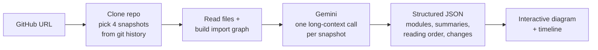

# RepoLens

**AI-generated architecture diagrams for any GitHub repository, and how that architecture changed over time.**

Paste a public GitHub URL. RepoLens reads the code, works out the main modules and how they depend on each other, and draws an interactive diagram. A timeline slider steps through the project's git history, so you can see the architecture grow: modules appearing, splitting and disappearing.

READMEs explain how to *use* a project. RepoLens shows how it's *built* and how it got that way.

---

## Features

- **Architecture diagram**: the main modules of the codebase as a graph, with arrows showing which module depends on which.
- **Timeline slider**: snapshots across the git history, each with a note on what changed since the previous one.
- **Module drill-down**: pick a module to see its files and a one-line summary of each.
- **Reading order**: the files a newcomer should read first, in order.
- **Multi-language**: Python, JavaScript/TypeScript, Java and Go.

---

## How it works



1. **Snapshots from history**: clones the repo and picks 4 commits spread evenly across its history. Files are read straight from git objects, with no checkout needed.
2. **Dependency graph**: reads import statements in each language and turns them into a file-to-file dependency graph. No LLM is involved in this step.
3. **Long-context analysis**: for each snapshot, the full codebase (the start of every file plus the dependency graph) goes to Gemini in **a single call**, so the model sees the whole project at once instead of in fragments.
4. **Structured output**: Gemini returns JSON (modules, file summaries, reading order and change notes). This is checked in code: file paths the model made up are dropped, and files it missed go into an "Other" module.
5. **Module graph**: file-level imports are rolled up into module-to-module edges, weighted by the number of imports.

### Engineering details

- **Parallel analysis**: the latest snapshot is analyzed first and its module names are reused for the older snapshots, which then run in parallel. That's 2 rounds of LLM calls instead of one per snapshot, and module names stay consistent across the timeline.
- **Change notes without extra calls**: each snapshot also gets the previous snapshot's file list, so the model can describe what changed in the same request.
- **Built for unreliable APIs**: at startup it pings several Gemini models in parallel and uses the fastest. If one is overloaded or times out, it falls back to the next model and retries with increasing waits.
- **Caching**: results are saved as JSON, so demo repositories load instantly with no API calls.

---

## Tech stack

| Part | Tool |
|---|---|
| LLM | Google Gemini API (`google-genai`) |
| Dependency graph | Regex-based import parsing into a file → file edge list |
| Visualization | pyvis |
| UI | Streamlit |
| Repo access | git (bare clone, `cat-file --batch`) |

---

## Run locally

```bash
git clone https://github.com/kuldeep-iiitd/repolens.git
cd repolens
python3 -m venv venv && source venv/bin/activate
pip install -r requirements.txt
```

Create a `.env` file with your Gemini API key (free from [Google AI Studio](https://aistudio.google.com/apikey)):

```
GEMINI_API_KEY=your-key-here
```

Start the app:

```bash
streamlit run app.py
```

Optional: precompute a repo so it loads instantly as a demo button:

```bash
python core.py https://github.com/psf/requests
```

---

## Project structure

```
repolens/
├── core.py           # git snapshots, import graph, Gemini calls, caching
├── app.py            # Streamlit UI: diagram, timeline, drill-down
├── cache/            # precomputed results for demo repos
└── requirements.txt
```

---

## Configuration

| Variable | Purpose |
|---|---|
| `GEMINI_API_KEY` | Required. Your Gemini API key. |
| `GEMINI_MODELS` | Optional. Comma-separated list of models to choose from, e.g. `gemini-3.5-flash,gemini-3.8-flash` |

## Limitations

- Public repositories only.
- Up to 300 source files per snapshot. Only the first ~30 lines of each file are sent to the model.
- Import parsing is regex-based, so unusual import styles (dynamic imports, path aliases) may be missed.
